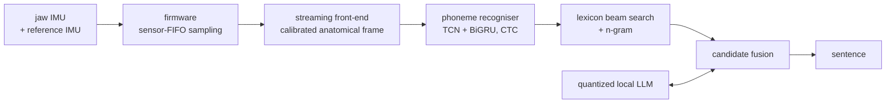

# silent-speech-jaw

Open-vocabulary silent speech from two small IMUs. Mouth a sentence without a
sound; a sensor on the jaw and one behind the ear measure the movement, a
phoneme recogniser turns it into phoneme posteriors, and a pronunciation
lexicon, an n-gram model and a quantized local LLM turn those into the sentence.
Everything runs locally, down to an Arduino UNO Q.

`ssj decode` on a simulated session from the quick start:

```text
[   32.6s +2.8s] They formed a human chain.   confidence 0.98
    phonemes: DH EY F AO R M T AH Y UW M AH N JH EY D
[   36.2s +2.5s] Tom will be thirty in march.   confidence 0.96
    phonemes: T AA M W AH L M IY TH ER N IY IH N P AA R CH
```

The phoneme lines are the recogniser's raw best guess, and they show why the
language stage exists. A jaw sensor cannot tell
`B` from `M` or `P`, or `CH` from `JH`: they are the same movement. The
recogniser reports what it can see, and the ambiguity is resolved by language
and context instead of being guessed away.

## How it works



| Stage | What it does |
| --- | --- |
| **Firmware** | Two LSM6DSOX IMUs sampled through their own FIFOs at 208 Hz, sent as CRC-checked binary frames. The firmware knows nothing about words. |
| **Calibration** | A 20-second routine recovers each sensor's orientation and the jaw's hinge axis, so features live in a frame fixed to the anatomy rather than to how the sensors were taped on. |
| **Front-end** | Causal streaming features: jaw, reference and jaw-minus-reference motion with head movement cancelled. Offline and live processing are bit-identical. |
| **Recogniser** | A 0.78 M-parameter network trained with a two-resolution CTC loss: phonemes, and the articulatory classes a jaw sensor can actually separate. Exported to ONNX. |
| **Decoder** | CTC beam search over a pronunciation trie with an n-gram model. Any word in the lexicon can be decoded without having been recorded. |
| **LLM** | A 4-bit GGUF model proposes sentences under a grammar built from the decoder's word lattice and scores all candidates in context. A candidate only wins if the sensor evidence supports its pronunciation. |

The design and the reasoning behind it are in [docs/architecture.md](docs/architecture.md).
It builds on [6ix](https://github.com/LakshyaV/6ix), which recognised a fixed set
of jaw-gesture commands with the same sensor pair.

## Install

```bash
git clone https://github.com/LakshyaV/silent-speech-jaw.git
cd silent-speech-jaw
python -m venv .venv && source .venv/bin/activate
pip install -e ".[all]"
```

Python 3.10 or newer. The extras can be installed separately: `serial` (USB
acquisition), `train` (PyTorch), `runtime` (ONNX Runtime), `llm` (llama.cpp).

## Quick start

No hardware is needed for a first end-to-end run: the built-in simulator renders
text into dual-IMU recordings with random sensor mounts and head motion.

```bash
# language resources: pronunciation dictionary, text corpus, quantized LLM, n-gram model
ssj assets fetch lexicon corpus llm
ssj lm build

# simulate sessions, build features, train, tune, evaluate on a held-out session
ssj sim --out data/sim --sessions 12 --utterances 240 --pool assets/corpus/sentences.txt
ssj data build --raw data/sim --out data/sim-feats
ssj train --data data/sim-feats --out runs/sim
ssj tune --bundle runs/sim/bundle --data data/sim-feats --out runs/sim/tuned.yaml
ssj eval --bundle runs/sim/bundle --data data/sim-feats -c runs/sim/tuned.yaml

# replay a session through the live decoding path
ssj decode --bundle runs/sim/bundle --session data/sim/sim/s11 -c runs/sim/tuned.yaml --limit 10
```

With the sensors connected ([hardware](docs/hardware.md)):

```bash
ssj monitor                                   # check sample rate and loss
ssj record --subject s01                      # calibration + guided prompts
ssj data build --raw data/raw --out data/s01
ssj train --data data/s01 --out runs/s01 --init runs/sim/checkpoint.pt
ssj live --bundle runs/s01/bundle             # mouth a sentence, read it on screen
```

The complete process, including session adaptation and on-board deployment, is
in [docs/workflow.md](docs/workflow.md).

## Commands

| Command | Purpose |
| --- | --- |
| `ssj assets` | fetch the lexicon, a text corpus and a quantized LLM |
| `ssj lm` | build the n-gram language model |
| `ssj prompts` | select phonetically balanced recording prompts |
| `ssj monitor` | live sample rate, jitter and loss of both sensors |
| `ssj record` | calibrated, prompted recording session with per-trial checks |
| `ssj sim` | simulated sessions for pre-training and hardware-free runs |
| `ssj data` | sessions to a feature dataset, split by session |
| `ssj train` | train the recogniser, export an ONNX bundle |
| `ssj export` | export a checkpoint to an ONNX bundle |
| `ssj adapt` | fit a session adapter from a short enrolment recording |
| `ssj tune` | tune decoding and fusion weights on held-out data |
| `ssj eval` | phoneme, class and word error rates per stage |
| `ssj inventory` | inspect confusions, refine the phoneme classes from them |
| `ssj decode` | decode a stored session as a continuous stream |
| `ssj live` | live decoding from the sensors |
| `ssj app` | package the Arduino UNO Q application |

Every option and its default is listed in [configs/default.yaml](configs/default.yaml).

## Repository layout

```text
firmware/ssj_streamer/   dual-IMU streamer (Arduino UNO Q and other boards)
app/                     Arduino UNO Q App Lab application
src/ssj/
  io/                    wire protocol, sample sources, session storage
  dsp/                   calibration, streaming front-end, activity segmentation
  phonology/             phoneme inventory, lexicon, text normalisation
  sim/                   articulatory kinematic simulator
  collect/               prompt design, guided recording, quality checks
  data/                  dataset building, augmentation
  models/, train/        recogniser, CTC objective, training, adaptation, export
  decode/                n-gram model, lexicon beam search, CTC scoring, lattices
  llm/                   llama.cpp backend, lattice grammars, evidence fusion
  eval/                  error rates, confusion analysis, tuning
  runtime/               ONNX bundles, pipeline, live loop
configs/default.yaml     all options
docs/                    architecture, workflow, hardware, protocol, deployment
tests/                   unit and integration tests
```

## Documentation

- [Architecture](docs/architecture.md): design, rationale, related work
- [Workflow](docs/workflow.md): resources, recording, training, evaluation, live use
- [Hardware and firmware](docs/hardware.md): parts, placement, wiring, build options
- [Wire protocol](docs/protocol.md): frame format between firmware and host
- [Deployment](docs/deployment.md): running on the Arduino UNO Q

## Development

```bash
make check        # lint, format check, tests
make firmware     # compile the sketch for the UNO Q (needs arduino-cli)
```

See [CONTRIBUTING.md](CONTRIBUTING.md).

## License

MIT, see [LICENSE](LICENSE). The bundled core lexicon is derived from the CMU
Pronouncing Dictionary; see [THIRD_PARTY_NOTICES.md](THIRD_PARTY_NOTICES.md).
