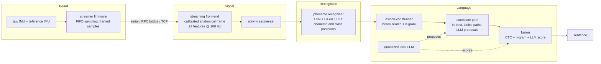

# Architecture

silent-speech-jaw turns the motion of a wearer's jaw, measured by two small
IMUs, into text. This document explains the design: what was carried over from
the fixed-command predecessor ([6ix](https://github.com/LakshyaV/6ix)), what had
to change to recognise *any* word, and why each stage is built the way it is.

## From fixed phrases to open vocabulary

6ix classified a jaw movement into one of a handful of commands. One feature
vector per trial, one class per command. That formulation cannot grow: every
new word needs its own recordings, and the classes become harder to separate
with every word added.

Open vocabulary needs a unit smaller than the word. Words are made of phonemes,
and a pronunciation dictionary maps 135,000 English words onto 39 of them. If
the phoneme sequence can be estimated from the jaw, every word in the dictionary
becomes recognisable without ever having been recorded.

The catch is that a jaw sensor does not see phonemes. It sees the mandible, and
the mandible is a secondary articulator: `pat`, `bat` and `mat` are the same
movement. The whole architecture follows from taking that seriously:

1. recognise phonemes **at the resolution the sensor actually has**;
2. keep the resulting ambiguity explicit instead of guessing through it;
3. resolve it with language: a pronunciation lexicon, an n-gram model, and a
   small local LLM that is given the candidates and the context.



## What 6ix established

| Lesson from 6ix | Consequence here |
| --- | --- |
| A reference IMU behind the ear lets head motion be separated from jaw motion. | Kept. The two sensors are now rotated into one frame first, so `jaw - reference` cancels head motion exactly instead of approximately. |
| Subtracting a rest baseline and scoring motion as a robust z-score gives a reliable event detector with hysteresis. | Kept and made continuous: baselines track during detected rest, and the same detector trims training utterances and endpoints live speech. |
| Trials need structure: stillness, a cued window, stillness. | Kept. The window length now follows the prompt's phoneme count and the label is a phoneme sequence. |
| The nominal sample rate was not the delivered one (100 Hz requested, ~45 Hz received, with jitter). | Samples are taken by the sensor's own FIFO and clock; everything downstream is resampled by timestamp; the link is measured before recording. |
| Raw-axis features were accurate within a session and fragile across mounts; rotation-invariant magnitudes were robust but discarded information. | A calibration routine recovers the anatomical axes, giving features that are both mount-independent and complete. |
| The reference sensor alone classified commands well above chance. | It is given to the model as a stream of its own, and reference-only training is a standard control. |
| Random splits within a session were optimistic; a held-out session is the real test. | Datasets are split by session by default, and say so when they cannot be. |
| A label inversion and a feature-order mismatch between training and live code cost debugging time. | One front-end implementation for both; bundles carry class names, normalisation and a front-end fingerprint that is checked on load. |
| Pickled scikit-learn models broke across library versions. | Models are exported to ONNX. |
| A clench makes a good deliberate control gesture. | It is a token in the inventory, decoded like any phoneme. |
| Vocabulary was compiled into the firmware. | The firmware measures and time-stamps; it knows nothing about words. |

## What a jaw IMU can observe

| Property | Observable? | How |
| --- | --- | --- |
| Jaw opening (vowel height) | well | rotation about the hinge axis; gravity tilt gives the absolute angle |
| Closures (bilabial, alveolar, sibilant) | well | fast raising of the jaw to characteristic heights |
| Rounding, protrusion | partly | fore-aft acceleration |
| Place of articulation | partly | soft-tissue tilt under the sensor as tongue and mouth floor move |
| Stop releases, clench | partly | high-frequency skin vibration |
| Voicing (P vs B) | no | nothing moves differently |
| Nasality (B vs M) | barely | slightly different timing |

The inventory therefore has two levels ([arpabet.yaml](../src/ssj/phonology/data/arpabet.yaml)):
40 fine tokens (39 phonemes plus `CLENCH`) grouped into 19 articulatory classes
such as `C_BILABIAL = {P, B, M}`. The grouping is a prior; `ssj inventory refine`
replaces it with one measured from the trained recogniser's confusions.

In the bundled 8,000-word core lexicon, 863 groups of words share one class
sequence (the largest has 13 members: *bait, bed, bet, made, maid, main, mate,
men, met, paid, pain, pen, pet*). This is the ambiguity the language stage exists for.

## Stages

### 1. Acquisition

Two LSM6DSOX IMUs, +-4 g and +-500 dps, 208 Hz. The firmware
([firmware/ssj_streamer](../firmware/ssj_streamer)) lets each sensor batch its
own samples in its FIFO, drains them, and sends one framed sample per sensor
([protocol](protocol.md)). Samples travel as raw LSBs with the scale factors in
an INFO frame. Because each IMU has its own oscillator, the two streams are
never paired on the wire.

The host stores sessions exactly as received (`samples.bin`, `events.jsonl`).
Every derived quantity is recomputed from that record.

### 2. Calibration: an anatomical frame

Twenty seconds at the start of a session ([calibration.py](../src/ssj/dsp/calibration.py)):

- **rest** gives gyro biases and each sensor's gravity vector;
- **nod and shake** gives the rotation between the two sensors: both sense the
  same rigid rotation, each in its own frame, and the best rotation between the
  two sets of gyro vectors is the solution of Wahba's problem (SVD);
- **open and close** gives the hinge axis: the principal axis of the *relative*
  rotation.

Hinge axis and gravity define a frame fixed to the anatomy: x along the hinge
(opening positive), z up. In that frame, channel 0 of the relative gyro is jaw
opening velocity for every session and every wearer.

### 3. Front-end

[frontend.py](../src/ssj/dsp/frontend.py) is a causal streaming processor:
timestamp resampling to a 200 Hz grid, rotation into the canonical frame,
anti-alias filtering and decimation to 100 Hz, a high-frequency vibration
envelope, and a rest tracker that maintains gravity baselines, residual gyro
bias and the angle zero. It emits 23 channels in four groups:

| Group | Channels | Content |
| --- | --- | --- |
| `jaw` | 6 | jaw angular rate, jaw acceleration minus rest gravity |
| `ref` | 6 | the same for the reference IMU |
| `rel` | 9 | jaw minus reference: rate, acceleration, integrated angle |
| `env` | 2 | log vibration envelope of each sensor |

Feeding it a whole session at once or live in 20 ms chunks gives bit-identical
output, which is tested. A model is only run on features whose front-end
fingerprint matches its own.

### 4. Phoneme recogniser

[encoder.py](../src/ssj/models/encoder.py): a per-session affine input adapter,
one convolutional stem per stream group, a strided fusion convolution (50 Hz),
residual dilated depthwise-separable convolutions, a bidirectional GRU and a
linear layer onto the 41 output units. About 0.78 M parameters.

Normalisation layers compute their statistics over valid frames only and the
backward GRU reverses each sequence within its own length, so an utterance gives
the same output alone as in any batch.

### 5. Multi-resolution CTC

A plain phoneme CTC loss punishes the model for confusing P with B, which the
sensor makes unavoidable; the model responds by memorising spurious cues. The
objective ([ctc.py](../src/ssj/models/ctc.py)) trains one output distribution at
two resolutions:

```
L = (1 - w) * CTC(p_phoneme, y) + w * CTC(p_class, class(y))
```

`p_class` is not a second head. It is the marginal of the phoneme distribution
over each class, so both terms share one alignment and the class posterior used
later for decoding is exact. An intermediate-layer CTC term regularises the
convolutional stack.

Training uses augmentation that follows the physics of the sensor pair: rigid
head motion injected identically into both sensors, small rotations for residual
calibration error, tempo changes with rates scaled accordingly.

### 6. Decoding

[beam.py](../src/ssj/decode/beam.py) searches a pronunciation trie with the CTC
posteriors and an n-gram model, merging alignments by log-add, and returns an
N-best list. Before the search, phoneme scores are blended with their class
scores:

```
score(p) = (1 - tau) * log P(class(p)) + tau * log P(p)
```

At `tau = 0` every member of a class has the class's score: homophene words tie
acoustically and the language model decides. At `tau = 1` the recogniser's
phoneme identities are trusted. `tau` is tuned on held-out data, so the system
measures how much phonetic detail the sensor delivers rather than assuming it.

The N-best list is also turned into a confusion network: per-position word
alternatives with posteriors. It represents the multiplicative space of
homophene combinations that an N-best list can only sample.

### 7. LLM stage

Small LLMs cannot transcribe a phoneme string directly: given `HH AH L OW` they
echo it back. What they do well is judge which of several sentences is the
natural one in context. The LLM stage ([fusion.py](../src/ssj/llm/fusion.py)) is
built around that.

Candidates come from four proposers:

1. the beam search's N-best;
2. the best paths of the confusion network under the n-gram model;
3. the LLM generating under a **grammar compiled from the confusion network**,
   so it can only produce sentences made of sensor-supported words;
4. the LLM writing freely from the detected phonemes and the best guesses.

Every candidate, whoever proposed it, is scored the same way:

```
total = w_am    * log P_ctc(pronunciation | sensor)     exact CTC forward score
      + w_ngram * log P_ngram(words)
      + w_llm   * log P_llm(sentence | context)
      + w_words * number of words
```

The LLM may propose anything, but a proposal wins only if its pronunciation is
supported by the sensor evidence. A fluent hallucination has a terrible CTC score
and is discarded. The LLM contributes context, syntax and world knowledge and is
never trusted on what was articulated.

Accepted sentences become context for the following ones, and a free-text
situation hint can be supplied. The LLM runs locally through llama.cpp from a
4-bit GGUF file; scoring re-uses the prompt's KV cache, so a candidate costs one
forward pass over about a dozen tokens.

### 8. Sessions and adaptation

Calibration removes the geometric part of a new mounting. What remains (gain,
lever arm, skin coupling) is absorbed by the per-session input adapter.
`ssj adapt` fits only that adapter, 552 numbers, on a short enrolment set with
the recogniser frozen, and exports a bundle with the adapter baked in.

### 9. Simulator

[ssj.sim](../src/ssj/sim) renders text into what the two IMUs would report:
phoneme targets blended by a smooth second-order-like dynamic, rigid-body
kinematics of a sensor on the mandible and one on the skull, head motion,
arbitrary mounting rotations, per-sensor clocks, bias, noise and quantisation.
Voiced and voiceless pairs have identical targets, so simulated data carries the
same homophene ambiguity as the real signal. It is used to pre-train the
recogniser before fine-tuning on recordings, and it provides ground truth
against which calibration, front-end and decoder are tested numerically.

## Evaluation

`ssj eval` runs the exported bundle through the runtime pipeline and reports
each stage separately, because they fail differently:

| Metric | Measures |
| --- | --- |
| phoneme / class error rate | the recogniser alone |
| first-pass WER | beam search with the n-gram model |
| oracle WER | the best sentence in the candidate pool: the ceiling for rescoring |
| final WER | after fusion with the LLM |

Controls: training on shuffled labels must not learn; training on the reference
stream alone shows how much is explained without the jaw sensor.

## Related work

- Srivastava et al., *MuteIt: Jaw Motion Based Unvoiced Command Recognition Using
  Earable*, IMWUT 6(3), 2022. Twin-IMU jaw sensing with a head-motion reference;
  words reconstructed from phoneme-level units.
- Srivastava et al., *Unvoiced: Designing an LLM-assisted Unvoiced User Interface
  using Earables*, SenSys 2024. Jaw-motion IMU sensing combined with an LLM.
- Willett et al., *A high-performance speech neuroprosthesis*, Nature 2023. The
  same decoding structure in another modality: a phoneme-level neural decoder,
  an n-gram language model, and rescoring by a large language model.
- Graves et al., *Connectionist Temporal Classification*, ICML 2006.
- Lee and Watanabe, *Intermediate Loss Regularization for CTC-based Speech
  Recognition*, ICASSP 2021.
