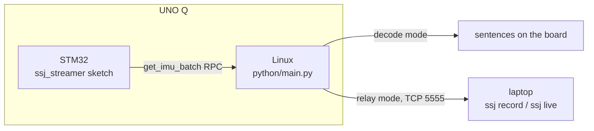

# Deployment on the Arduino UNO Q

The UNO Q has two processors: an STM32 microcontroller that samples the IMUs and
a Qualcomm Linux system that can run the whole recogniser. The two talk through
Arduino's RPC bridge. `ssj app package` assembles an Arduino App Lab application
for either of two roles.



## Relay mode: record and decode on a laptop

The board forwards the raw frame stream over TCP. Use this for recording
sessions and for decoding with larger models.

```bash
ssj app package --relay --out dist/ssj-relay
```

Copy `dist/ssj-relay` to the board, open it in Arduino App Lab and press **Run**.
The app exposes TCP port 5555 (`ports` in `app.yaml`). On the laptop:

```bash
ssj monitor --source tcp:<board-ip>:5555
ssj record  --source tcp:<board-ip>:5555 --subject s01
ssj live    --source tcp:<board-ip>:5555 --bundle runs/s01/bundle
```

Over USB without a network: `adb forward tcp:5555 tcp:5555`, then use
`tcp:localhost:5555`.

## Decode mode: everything on the board

```bash
ssj export --checkpoint runs/s01/checkpoint.pt --out bundles/s01
ssj lm build --vocab-size 12000 --out assets/lm/board.npz
ssj assets fetch llm --llm-preset tiny
ssj app package --bundle bundles/s01 --lm assets/lm/board.npz \
                --lexicon assets/lexicon/cmudict.dict \
                --llm assets/llm/smollm2-360m-instruct-q4_k_m.gguf \
                --config runs/s01/tuned.yaml --out dist/ssj-app
```

Copy `dist/ssj-app` to the board, open it in App Lab and press **Run**. The first
start installs the Python requirements, which includes compiling llama.cpp and
takes several minutes. The console then shows output of this form:

```text
starting silent-speech-jaw (decode mode)
MCU ready: sensors_ready=1,jaw=ok,ref=ok,mode=fifo,odr_hz=208,...
model: 786,537 parameters | 40 phonemes / 19 classes | ...
calibration 1/3  REST - mouth closed, head still
calibration 2/3  HEAD - jaw relaxed: nod, shake, then tilt your head
calibration 3/3  JAW - head still: start closed, open and close slowly
calibration: full

listening - mouth a sentence, then pause.

>>> Can I have a glass of water.    [0.93, 1900 ms]
```

Decoded sentences are passed to `handle_sentence()` in `python/main.py`, which is
the place to connect speech synthesis, a display or actuators.

### What the folder contains

```text
dist/ssj-app/
  app.yaml
  sketch/              the streamer firmware (bridge transport) and its build profile
  python/
    main.py            Linux-side program
    requirements.txt
    ssj/               the runtime package
    bundle/            model.onnx, bundle.json
    assets/            lm.npz, lexicon.dict (optional), *.gguf
    config.yaml        tuned decoder weights
    settings.env       mode, relay port, LLM hint
```

### Settings

Settings are stored in `python/settings.env`, written by `ssj app package`.
Environment variables of the same name take precedence.

| Variable | Default | Meaning |
| --- | --- | --- |
| `SSJ_MODE` | set by `app package` | `decode` or `relay` |
| `SSJ_HINT` | empty | situation description given to the LLM |
| `SSJ_LLM` | the `.gguf` in `assets/` | another model path; remove the file to run without an LLM |
| `SSJ_LM`, `SSJ_LEXICON`, `SSJ_BUNDLE`, `SSJ_CONFIG` | files in the app folder | override individual resources |
| `SSJ_RELAY_PORT` | `5555` | relay mode TCP port; `app package --port` also updates `app.yaml` |

### Sizing for the board

| Component | Size | Notes |
| --- | --- | --- |
| recogniser (ONNX) | 3.2 MB | a few milliseconds per utterance on one laptop core |
| n-gram | 16 bytes per n-gram | build with `--vocab-size`, `--order 2` or a higher `--min-count` to shrink it |
| lexicon and trie | about 20 MB of RAM per 30k words | `app package` ships only the words the n-gram knows |
| LLM | the GGUF file plus its context | `tiny` on the 2 GB board, `small` or `base` on the 4 GB board |

The LLM is the dominant cost per sentence. Fewer candidates mean fewer forward
passes: lower `pipeline.fusion.rescore_top`, or set
`pipeline.fusion.free_proposal: false` to skip the unconstrained proposal.
