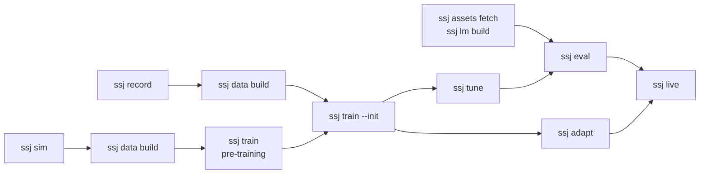

# Workflow: from sensors to sentences

Every step is an `ssj` command. Each command prints `--help` with examples, and
every option has a default documented in [`configs/default.yaml`](../configs/default.yaml).



## 1. Language resources (once)

```bash
ssj assets fetch lexicon corpus llm     # CMUdict, a sentence corpus, a quantized LLM
ssj lm build                            # trigram model over the 30,000 most frequent words
ssj assets list
```

The n-gram vocabulary decides which words the decoder can produce: the most
frequent corpus words that the lexicon can pronounce. To adapt the system to how
you talk, add your own text and rebuild:

```bash
ssj lm build --text assets/corpus/sentences.txt --text my_messages.txt
```

## 2. Pre-train on simulated sessions

The simulator renders text into dual-IMU recordings with random sensor mounts,
clocks and head motion. Pre-training on it teaches the recogniser the mapping
from jaw kinematics to phoneme sequences before it sees a recording.

```bash
ssj sim --out data/sim --sessions 12 --utterances 240 --pool assets/corpus/sentences.txt
ssj data build --raw data/sim --out data/sim-feats
ssj train --data data/sim-feats --out runs/sim
```

Training prints the phoneme and class error rate on a held-out session after
every epoch and exports the best model to `runs/sim/bundle`.

## 3. Record

Check the link, then record a session ([hardware](hardware.md)):

```bash
ssj monitor
ssj record --subject s01 --note "left jaw angle, cable over the ear"
```

A session runs like this:

1. **Link check.** Effective sample rates and loss are measured and reported.
2. **Calibration**, about twenty seconds, three cued phases: rest; nod, shake and
   tilt the head with the jaw relaxed; open and close the jaw slowly with the
   head still, starting closed.
3. **Prompts.** For each prompt: *ready* (keep still), *GO* (mouth it once,
   silently, at a natural pace), *relax*. Each trial is checked immediately:
   movement present, not started before the cue, not cut off, stream intact. A
   flagged trial says what to change and is repeated.

Prompts are selected for phoneme and diphone coverage: isolated-word drills that
put every phoneme at the start, middle and end of a word, then sentences chosen
by greedy set cover. Each session gets a different, equally balanced list. To
draw sentences from a larger pool or to include the `<clench>` control gesture:

```bash
ssj prompts build --pool assets/corpus/sentences.txt --sentences 150 --clench-every 10 \
                  --seed 3 --out prompts/s01-03.jsonl
ssj record --subject s01 --prompts prompts/s01-03.jsonl
```

Record several sessions, taking the sensors off in between. Variation between
mounts is what the model has to become robust to, and a session that was not
trained on is what an honest test needs.

`--auto` runs hands-free: clean trials are accepted and flagged ones retried
without touching the keyboard.

## 4. Build the dataset and fine-tune

```bash
ssj data build --raw data/raw --out data/s01
ssj data info data/s01
ssj train --data data/s01 --out runs/s01 --init runs/sim/checkpoint.pt
```

`data build` calibrates each session from its own routine, runs the streaming
front-end over the session as one continuous signal, cuts out the utterances and
trims them to the detected articulation. The newest session of each wearer is
held out for testing and the one before it for validation; `data info` shows the
split and notes when a wearer has too few sessions for that.

Two controls are worth running on every new dataset:

```bash
ssj train --data data/s01 --out runs/control --control shuffled-labels   # must not learn
ssj train --data data/s01 --out runs/ref-only -s model.streams='[ref]'   # reference sensor alone
```

## 5. Tune and evaluate

```bash
ssj tune --bundle runs/s01/bundle --data data/s01 --out runs/s01/tuned.yaml
ssj eval --bundle runs/s01/bundle --data data/s01 -c runs/s01/tuned.yaml
```

`tune` searches the decoding parameters on the validation session. `eval`
reports, on the test session:

```
phoneme error rate   the recogniser alone
class error rate     the same at articulatory-class resolution
WER first pass       beam search with the n-gram model
WER oracle           best sentence among the candidates: the ceiling for rescoring
WER final            after fusion with the LLM
```

The gap between phoneme and class error rate is what the sensor cannot resolve;
the gap between first-pass and final WER is what the LLM contributes. Add
`--no-llm` to see the pipeline without it.

### Refining the phoneme classes

```bash
ssj inventory confusions --bundle runs/s01/bundle --data data/s01
ssj inventory refine --bundle runs/s01/bundle --data data/s01 --out configs/classes-s01.yaml
ssj data build --raw data/raw --out data/s01-refined --inventory configs/classes-s01.yaml
```

`refine` regroups the phonemes by how the trained recogniser actually confuses
them. Retraining on the refined inventory aligns the auxiliary loss and the
decoder with what this sensor placement can separate.

## 6. Run

Replay a recorded session through the live code path:

```bash
ssj decode --bundle runs/s01/bundle --session data/raw/s01/<session> -c runs/s01/tuned.yaml
```

Live:

```bash
ssj live --bundle runs/s01/bundle -c runs/s01/tuned.yaml --hint "ordering at a cafe"
```

After the calibration routine, mouth a sentence and pause. Accepted sentences
become context for the LLM, so a follow-up is interpreted in the light of what
came before; `--hint` gives it the situation up front. A low-confidence result
is shown with `?` and is not added to the context.

## 7. Adapt to today's mounting

A short enrolment recording fits the per-session input adapter while the
recogniser stays frozen:

```bash
ssj record --subject s01 --session today --words 20 --sentences 20
ssj data build --raw data/raw --out data/s01
ssj adapt --checkpoint runs/s01/checkpoint.pt --data data/s01 --session s01/today --out runs/today
ssj live --bundle runs/today/bundle -c runs/s01/tuned.yaml
```

## Choosing an LLM

| Preset | Model (4-bit GGUF) | Size | Intended for |
| --- | --- | --- | --- |
| `tiny` | SmolLM2 360M Instruct | 0.27 GB | beside the recogniser on a 2 GB board |
| `small` | Qwen2.5 0.5B Instruct | 0.49 GB | default |
| `base` | Qwen2.5 1.5B Instruct | 1.1 GB | 4 GB boards, laptops |
| `large` | Llama 3.2 3B Instruct | 2.0 GB | laptops |

```bash
ssj assets fetch llm --llm-preset tiny
ssj live --bundle runs/s01/bundle --llm assets/llm/smollm2-360m-instruct-q4_k_m.gguf
```

Any GGUF model works (`--llm path`). On Apple silicon or CUDA builds of
llama.cpp, `--gpu-layers -1` offloads the model.
